## Introduction

The Data Model Explorer is one HTML file that opens a Dataverse data-model workbook, checks it, lets you edit it, and turns it into a Dataverse solution you import with one script. It runs entirely in Chrome or Edge: nothing to install, it works offline, and the workbook never leaves your machine.

It is for anyone who owns or reviews a data model kept in the FormusPro template: functional consultants, solution architects and developers.

| Job | What you do in the page |
| --- | --- |
| Review | See the size and completeness of the model, search every field, run the automatic checks, draw the ERD |
| Edit | Change values, add fields, lookups and many-to-many relationships, set primary keys and table details |
| Compare | Load a newer version of the workbook, see every difference, and keep your edits |
| Build | Generate an unmanaged Dataverse solution, then import it with `import.ps1` |
| Share | Give a client or support team a read-only copy they can view but not change |
| Live | Inside Dynamics 365 or XrmToolBox: load a solution as the model, or check the workbook against the environment for undocumented and unmanaged changes |

This guide describes version 5.0.0, in the SharePointPCF repository under `data-model-explorer-v5`. Versions 1.9.3 (`data-model-explorer`), 2.0 (`data-model-explorer-v2`), 3.0 (`data-model-explorer-live`) and 4.0 (`data-model-explorer-v4`) stay as they are, with their own guides.

**New in 5.0**

- It also runs as an **XrmToolBox tool**, reading the environment XrmToolBox is connected to (Using it in XrmToolBox).

**New in 4.0**

- A tidier ERD panel: tables first, display settings folded under **Layout and options**, and the exports in one **Export ▾** menu (The ERD).
- A simpler header, in the order you work: the workbook, your changes, **Check**, **Save & share** and **Build solution** (The header).
- Read-only copies can download the workbook as an Excel file, formatting and edits included (Sharing a read-only copy).
- An empty page offers **Open workbook…** and **Download blank template** side by side.

**New in 3.0**

- The page can run inside a Dynamics 365 environment as a web resource and read the tables directly (Using it inside Dynamics 365).
- **Load a solution as the data model:** the model comes from what is really in the environment.
- **Check the workbook against the environment** in one click: undocumented tables, fields and N:N, fields not built yet, and differences.
- **Managed environments:** find anything created or changed directly in test or production (unmanaged).
- Opened as a file, it is the same page as 2.0.

**New in 2.0**

- The ERD is much faster: 300 tables and 900 relationships draw in about 2.5 seconds (78 seconds in 1.9.3), and dragging and hovering stay quick on big diagrams.
- Every lookup and N:N row in a diagram's table box has an eye, to hide or show that relationship (The ERD).
- **Direction** now shapes the layout (The ERD).
- **Save & share → Read-only copy (.html)…** makes a copy for a client or support team (Sharing a read-only copy).
- The file is 2.2 MB instead of 5.7 MB, so it opens faster.

## The header


**1** Workbook · **2** Changes · **3** Check · **4** Save & share · **5** Build solution · **6** How it works

| Button | What it does |
| --- | --- |
| Workbook (shows the file's name) | Load a newer version of this workbook, open another one, or switch to one kept in this browser |
| Changes | Every edit you have made, with a count. The label beside it says whether your edits are **kept in browser**; on a narrow screen it is a green or red dot |
| Check | Checks, Compare with a solution (or This environment), Publishers and prefixes, What changed (after loading a newer version) and Template. The count is errors plus warnings |
| Save & share | Save the workbook, make a read-only copy or a CSV, and the build and log downloads, in groups |
| Build solution | Turn the workbook into a Dataverse solution. Greyed out until a workbook is open |
| ? | How it works |

On a phone the buttons fold into one **⋯** menu.

## Opening (uploading) a workbook

Double-click `Data_Model_Explorer.html` to open it in Chrome or Edge, then open your workbook. The first time, the page opens on **Start here**.

1. Click **Open workbook…** under Start here (or **Workbook ▾ → Open another workbook…** in the header), or drag the `.xlsx` file onto the page.
2. A workbook in the template layout opens straight away. A **Metadata Document Generator export** is converted to the template layout first; a progress window shows the tables and fields converted. The converted file keeps the export's name.
3. The page opens on the **Overview**. Tables are listed in the sidebar, grouped by area when the Table Dictionary has areas.

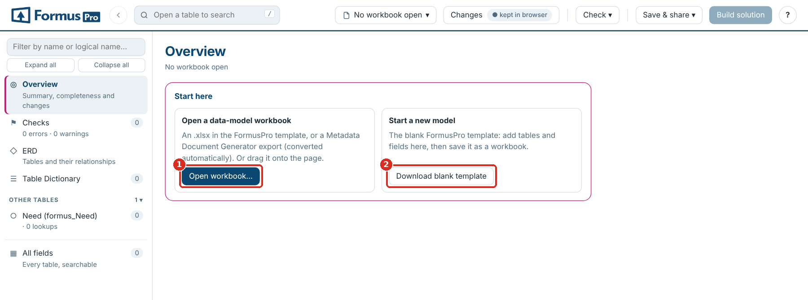

**1** Open workbook… · **2** Download blank template, to start a new model

**Browsers.** Chrome or Edge. Saving into your own file (Save) uses a feature only those browsers have (elsewhere Save downloads); everything else also works in other modern browsers.

## Switching between workbooks

**Opening a second file.** When a workbook with edits is open, the page asks whether the new file is a **newer version of the same workbook** (your edits carry over and the differences are shown) or a **different workbook** (it gets its own, separate set of edits).

**The workbook selector.** The button with the workbook's name in the header loads a newer version, opens another workbook, and lists every workbook kept in this browser; pick one to switch. **Manage files…** in the same menu shows them all, and **Remove all…** there clears them.

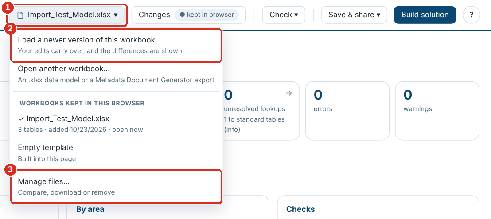

**1** The workbook selector · **2** Load a newer version of this workbook… · **3** Manage files…


**Where things are kept.** Open workbooks are stored in the browser (IndexedDB) and your edits, column choices and ERD layouts in local storage, for this browser profile only. They are not in the HTML file, so anyone you send the file to starts with just the empty template. The **kept in browser** label beside Changes confirms edits are stored; if the browser refuses to store them it says **not saved: export now**.

## Loading a new version

Click **Workbook ▾ → Load a newer version of this workbook…** (or drop the new file on the page) and choose **newer version** when asked.


**1** Newer version: carry edits over · **2** Different workbook: a separate set of edits

- **What changed** opens with every difference: tables and fields added or removed, values changed, columns added or removed, table details, forms and views, and lookup targets. **Version differences (CSV)** in Save & share downloads them. **Check ▾ → What changed** opens the list again. Tables are matched by tab name, fields by Logical Name, so row order doesn't matter.
- Your edits are re-applied. Where the new version changed a value you had edited, it is listed under **Needs your attention** in Changes: choose **Keep mine** or **Use new version**. An edit to a field the new version no longer has can be discarded there.
- Rows you added are carried over too. If the new version already has a field with the same logical name, you choose whether to keep the new version's or add yours as well.

## The Overview

The Overview is the landing page: it sizes the model, shows how complete it is, and links to what needs attention. Click **Overview** in the sidebar to come back to it.

| Card | What it shows |
| --- | --- |
| Counts across the top | Tables (custom and standard), fields, lookups, related table pairs, unresolved lookups, errors, warnings and your edits. Most cards open the matching list when clicked |
| Documentation completeness | Share of fields and tables with a description, dictionary entries with an area and a purpose, and the least described tables |
| By area | Tables, fields, how much is described and the number of issues, per area |
| Checks | The findings by check and severity, each linking to the full list |
| Build a Dataverse solution | Opens the solution builder |
| Latest changes | Your recent edits, or the differences from the previous version |
| Dataverse check | Whether the workbook has been compared with a Dataverse environment, and a button to start |

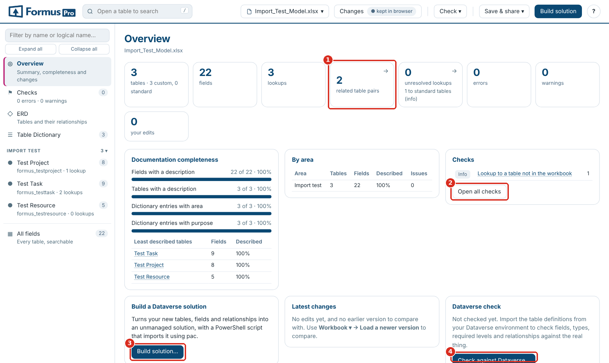

**1** Count cards open their list · **2** Open all checks · **3** Build solution… · **4** Compare with a solution…

When the page reopens a workbook from last time, the Overview says which one, so you can switch if it is not the one you want.

## Checks

**Checks** (in the sidebar, or **Check ▾ → Checks**) runs over the whole model and updates as you edit; clear the errors before you build a solution. Each finding names the table and field and opens it when clicked.

| Check | Severity | How to fix it |
| --- | --- | --- |
| No primary name column | Error | Set Primary Name Column in the table details (Set as primary name on a text field) |
| Primary name column not in the field list | Error | Add the field, or point Primary Name Column at an existing one |
| Primary name column is not single-line text | Error | Choose a Text field as the primary name |
| Primary key is not a unique identifier | Error | Leave Primary Key as the table name followed by `id`; use an alternate key for other unique fields |
| Table or field without a logical name | Error | Fill in Logical Name |
| Duplicate field, or same table on more than one tab | Error | Remove or rename the duplicate |
| Relationship name used twice | Error | Change one Relationship Name, or leave it blank to generate one |
| No attribute type | Warning | Fill in Attribute Type |
| Lookup without targets | Warning | Add `Targets:` and the table to Additional data |
| Lookup to a table not in the workbook | Warning | Add the table's tab, or check the logical name |
| Relationship type not valid here; Cascade Delete not recognised | Warning | Use `N:1` on a lookup, `N:N` on a relationship row; `Remove Link`, `Restrict` or `Cascade` |
| N:N relationship with an unknown table | Warning | Put exactly one table in `Targets:` |
| Dictionary entry with no tab; table missing from the dictionary | Warning | Match the Table Dictionary to the tabs |
| Relationship type not recorded | Info | Set Relationship Type to `N:1` on lookups you have confirmed |
| Calculated or rollup field to create by hand | Info | Nothing to fix: listed for after the import |
| Logical name format; custom field without a publisher prefix; no primary key field listed | Info | Usually Microsoft's own fields; check your own |
| Copy of a system field | Warning | A field such as `fp_createdon` would be a second copy of a column Dataverse creates on every table (`createdon`). Use the system field and remove the row; it is left out of a generated solution |
| Prefix not one of yours | Info | A custom field's prefix is neither one of your publishers' nor a Microsoft one. Add it in Publishers and prefixes if it is yours, or correct the name. Only checked once you have saved your publishers |

Checks starting "Dataverse" appear only after you load Dataverse metadata (see Comparing with a solution).

Use the **Errors**, **Warnings** and **Info** buttons (with their counts) to show or hide each severity, the **Area** filter to narrow the list, and the search box to find a table or field. **Export (CSV)** downloads the list.

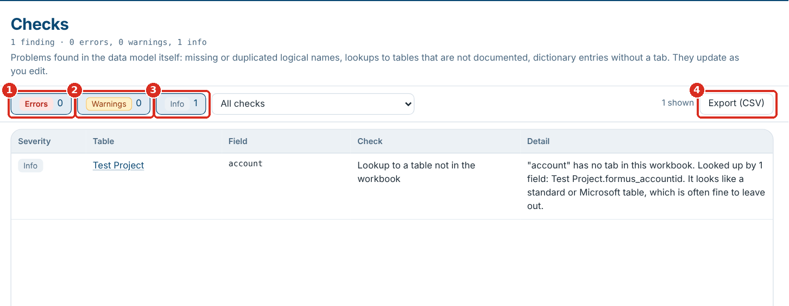

**1** Errors · **2** Warnings · **3** Info · **4** Export (CSV)

## The ERD

The **ERD** draws the tables you pick, joined by their lookups and N:N relationships, so the diagram always matches the workbook. The page draws it itself, so even a few hundred tables take only a few seconds.

The side panel has the tables at the top and the display settings at the bottom.

1. Pick tables under **Tables** (it says how many are ticked): tick them one by one, use **Custom only**, **All**, **None** or **Area ▾**, or type in the filter box and use **Tick all shown** (it appears while you filter).
2. Click ★ next to a table to make it a **core table**: the diagram is laid out around it, and with **Selecting a table also selects the tables it relates to** on, its neighbours come too.
3. Under **Show**, choose what each box shows: **Names only**, **Keys + lookups** or **All fields**. **Layout and options** (closed until you open it; the line under it sums up what is set) has the **Direction**, when relationship names show, which tables are drawn, and colour by area. **Left to right** turns a layout that comes out tall on its side, to fit a wide screen; **Top to bottom** gives a tall layout. Changing it lays the diagram out again.
4. Drag tables to tidy the layout; **Auto layout** starts again. Layouts are remembered per selection.
5. To leave out a relationship, click the eye at the end of its row in the table box. Every lookup row has one, and N:N relationships have their own rows (↔ the other table) on both tables. The line disappears; the row stays in the box, faded, with its eye crossed out, so clicking it again brings the line back. A lookup to a table is hidden from the row in the table that holds the lookup. With **Names only** there are no rows, so the table's header has one eye for all of its own relationships. **show all** in the side panel brings every hidden relationship back. The tables stay where they are, and the choice is remembered in this browser.

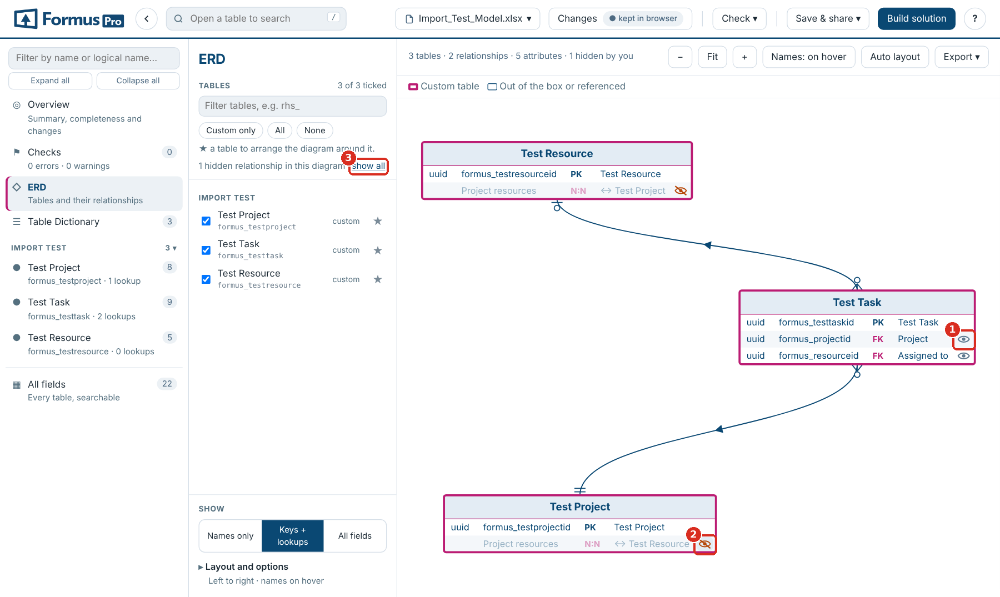

**1** Click to hide a relationship · **2** Hidden: click to show it again · **3** Show all

The diagram opens at the size of your screen, so a large model is readable straight away even where part of it runs past the panel: drag the background or scroll to move around, use the mouse wheel to zoom, or click **Fit** to see it all in the panel.

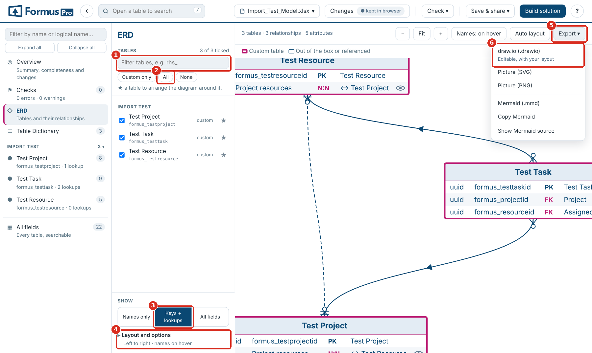

**1** Filter tables · **2** All tables · **3** Keys + lookups · **4** Layout and options · **5** Export ▾ · **6** draw.io

**Reading the lines.** Lines use crow's-foot ends: a fork for "many", bars for "one", a circle for "zero". A line shows its ends only where the relationship type is recorded in the workbook. A small arrow in the middle points to the table being looked up. A relationship whose type isn't recorded is drawn as a plain grey line and listed in Checks for review; N:N relationships are dashed. Custom tables have a pink border; standard tables and tables referenced but not in the workbook have a plain one.

**Options** (under Layout and options). Ticking a table also ticks the tables it relates to; show tables the ticked tables look up to; include tables not in the workbook; hide tables with no relationships; hide user, team and business unit; merge lines between the same two tables; colour by area.

**Exports.** **Export ▾** above the diagram: **draw.io** (an editable diagram), **SVG**, **PNG**, **Mermaid (.mmd)**, **Copy Mermaid** and **Show Mermaid source**. Exports show what you see: the tables you picked, your layout, and only the relationships you have not hidden. The eyes are left out. A whole large model is hard to read, so a few dozen tables at a time usually works best.

## Browsing and searching tables

Every table tab is a page: its details along the top, counts by field type, and the field list. **All fields** in the sidebar lists every field of every table in one searchable view.

- **Sidebar.** Tables grouped by area, with their field and lookup counts. Type in the box at the top to filter by name or logical name.
- **Search.** The box in the header (shortcut `/`) searches the open table, or every field in **All fields**.
- **Back.** The ← button beside the search box returns to the previous screen (a table, the Overview, Checks, the ERD), as do the browser's Back, `Alt`+`←` and a mouse's back button.
- **Column filters.** The funnel icon on any column header filters by its values. Active filters show above the grid with a × to clear each one.
- **Quick filters.** **Edited only** shows rows you have changed; **Area** (in All fields) limits the list to areas; the counts by field type filter to that type when clicked.
- **Columns ▾** shows or hides columns. Schema Name, Type and Relationship Name are hidden by default.
- **Expand / Collapse all rows** switches between full text and two-line rows; the ▾ on a row does it for that row.

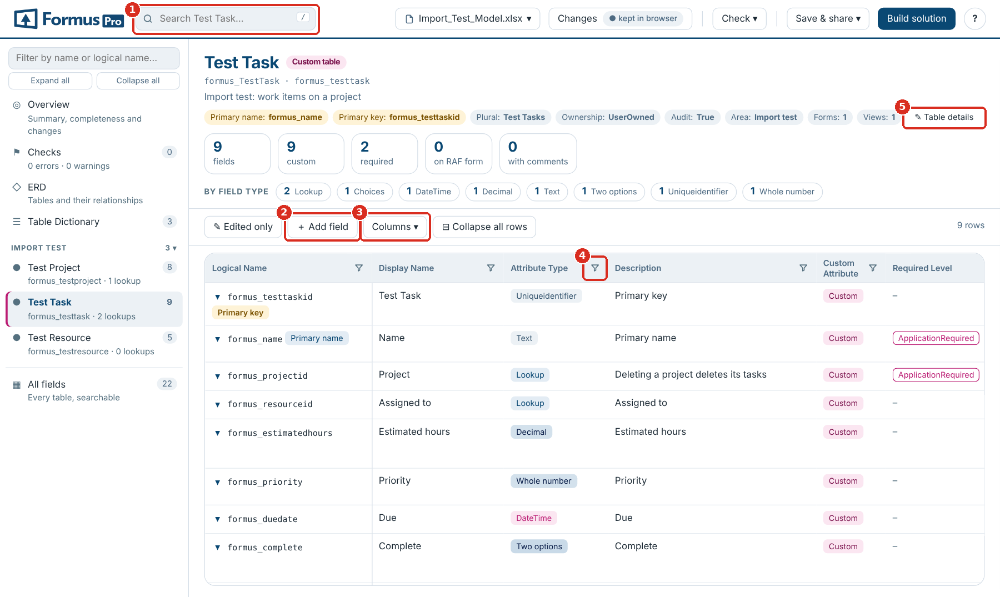

**1** Search · **2** ＋ Add field · **3** Columns ▾ · **4** Column filter · **5** ✎ Table details

## Editing values

- **Double-click a cell** to edit it, or click a row to open its panel on the right and click a value there. `Enter` saves, `Esc` cancels, `Shift`+`Enter` starts a new line in long text.
- Columns with a fixed set of values (Attribute Type, Required Level, Relationship Type, Cascade Delete and similar) edit as a **dropdown**; **＋ New value…** adds one.
- Edited cells are highlighted. The row panel shows the original value with **revert**, and the **Changes** button lists every edit.
- In the row panel, `j` and `k` (or ↑ ↓) move to the next and previous row.
- Changing a field's **Attribute Type** to **Lookup** asks which table it looks up to, then adds `Targets:` and the table to Additional data (and N:1 as the Relationship Type if it is blank). **Skip** leaves it for Checks to flag.
- A dropdown or any text that is cut short shows in full when you hover over it.

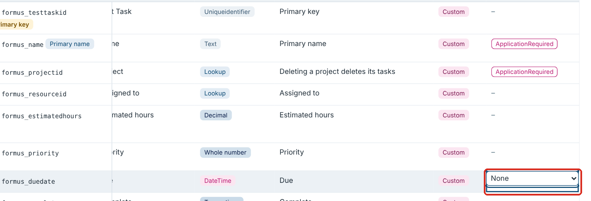

## Adding fields and relationships

**＋ Add field** on a table page adds a row at the end of its field list.

1. Choose **A field** or **An N:N relationship**.
2. Type the **Display name**. The **Logical name** and **Schema name** are suggested with your prefix (`Actual hours` becomes `formus_actualhours` and `formus_ActualHours`); type over them if you need to.
3. Pick the **Field type**. For a **Lookup** or an **N:N**, pick the **Related table**; the page fills in `Targets:` and the Relationship Type (`N:1` or `N:N`).
4. Click **Add**. The new row is tagged **ADDED** and opens on the right for everything else: choice options, length, format, cascade.


**1** A field or an N:N relationship · **2** Display name (the names follow it) · **3** Field type · **4** Add

A name already in the table is refused. To remove an added row, click **Remove row** in its panel, or **remove** under **Rows added** in Changes. On other sheets, such as the Table Dictionary, **＋ Add row** adds a blank row.

## Primary key, primary name and table details

- The table header shows the **Primary name** and **Primary key**. When the workbook doesn't record the key, it shows the table name followed by `id`, marked **(assumed)**; a missing primary name shows as **not set**.
- In the field list, those two fields are tagged **Primary key** and **Primary name**.
- To change them, open a field and click **Set as primary key** or **Set as primary name**. The primary name must be single-line text.
- **✎ Table details** in the header edits every detail row (ownership, notes, activities and the rest), including details the template has but the table lacks.

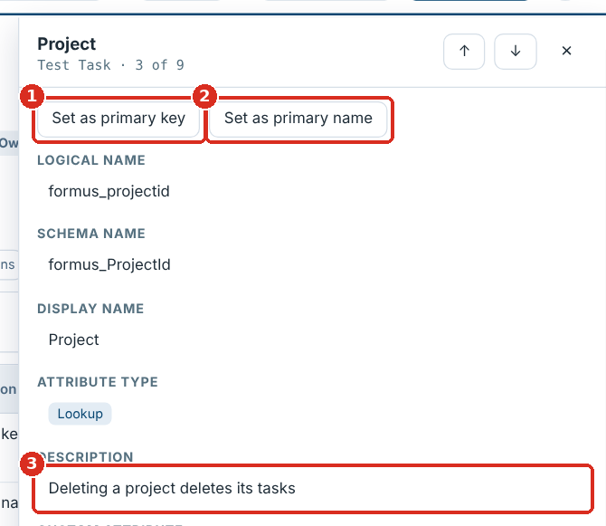

**1** Set as primary key · **2** Set as primary name · **3** Click a value to edit it

Dataverse primary keys are always unique identifiers (GUIDs) created with the table. Marking a text or number field as the key is flagged in Checks; to keep another field's values unique, use an alternate key in Dataverse.

## Reviewing and undoing your changes

**Changes** in the header lists rows you added, table details you changed, and every cell edit as original against new, each with **go** and **revert**. **Revert all** undoes everything; **Export log (CSV)** downloads the list.

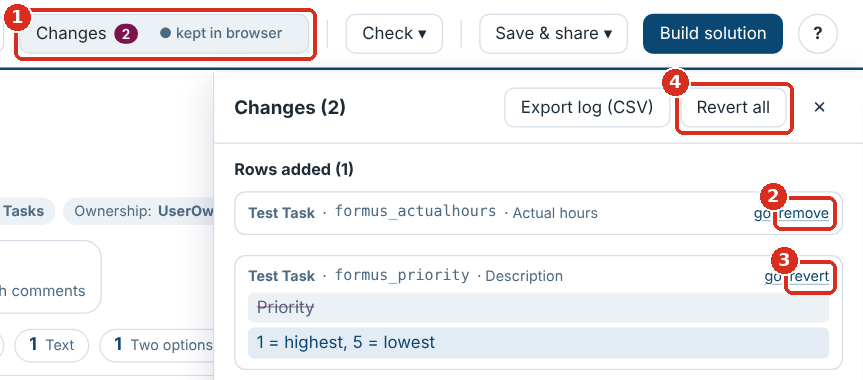

**1** Changes · **2** Remove an added row · **3** Revert one edit · **4** Revert all

## Saving and exporting

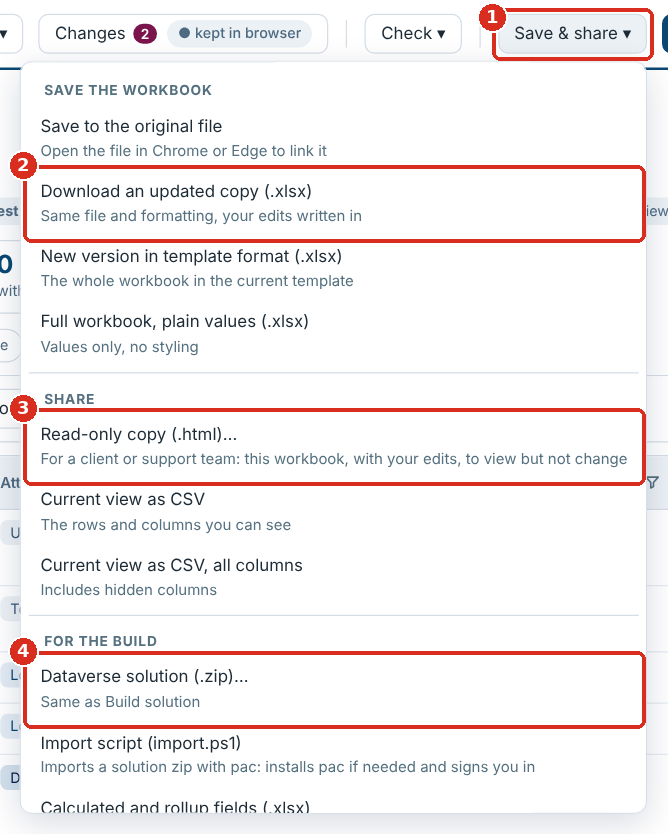

**1** Save & share ▾ · **2** Save · **3** Read-only copy · **4** Dataverse solution

The menu is in five groups: **Save**, **Other formats**, **Share**, **Build** and **Logs**.

| Save & share menu item | What you get |
| --- | --- |
| Save (`Ctrl`+`S`) | Writes your edits into your workbook. If the page isn't linked to a file yet (it was dragged in, or the file has moved), it asks where to save the first time and saves there from then on. In browsers that can't ask (Firefox, Safari) it downloads the workbook |
| Save as… | The same, into a new file you choose |
| Rebuilt in the current template (.xlsx) | The whole workbook laid out and styled by the template, with a Change log sheet |
| Values only, no formatting (.xlsx) | Every sheet's values, no styling |
| This view as CSV | The rows you can see, with the visible columns; tick **include hidden columns** for all of them |
| Change log (CSV) | Your edits |
| Read-only copy (.html) | A copy of the page holding this workbook, with your edits written in, that can be viewed but not changed (next section) |

Save and Save as only rewrite the cells you changed; formatting, validations and everything else stay byte for byte. Added rows go into the empty rows after the field list. A table detail the sheet doesn't have yet (for example Primary Name Column or Primary Key) goes into an empty row above the field list or, when there is none, into a row inserted just below the last detail: everything underneath moves down with it, including merged cells, dropdown lists, conditional formatting, filters and the frozen header, and anything elsewhere that points at those rows: named ranges, print titles, other sheets' formulas and charts. The file is then read back and every edit checked. If any edit can't be written (for example there is no empty row left before the Forms section, or the sheet has an Excel table, a drawing or comments, or a pivot table reads from it, so rows can't be inserted), **nothing is saved**, the reason is shown, and your edits are kept: use **Rebuilt in the current template** instead. If another program changed the file since you opened it, Save asks before overwriting it.

If the file has been moved, renamed or deleted since you opened it, **Save** says so and offers **Save as…**: pick a folder and a name, and the page saves there from then on. To see which version of the page you are using, hover the **?** button or open **How it works**.

Every workbook download asks for a file name first, suggesting the next version: `Model v1.2` becomes `Model v1.3`, `Model 1.4` becomes `Model 1.5`, and other names get `(updated)` or `(edited)`.

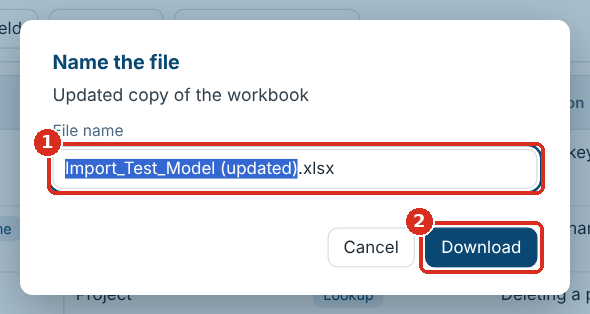

**1** Type the name · **2** Download

## Sharing a read-only copy

Use a read-only copy when a client or a support team needs to look at the model without changing it.

1. Open the workbook and make any edits you want them to see.
2. **Save & share ▾ → Read-only copy (.html)…**.
3. Name the file (it suggests `<workbook> (read-only).html`) and click **Download**.
4. Send the file like any other. It is about 2.2 MB and opens in Chrome or Edge with nothing to install.

The copy opens straight onto that workbook and says **Read-only** in the header.

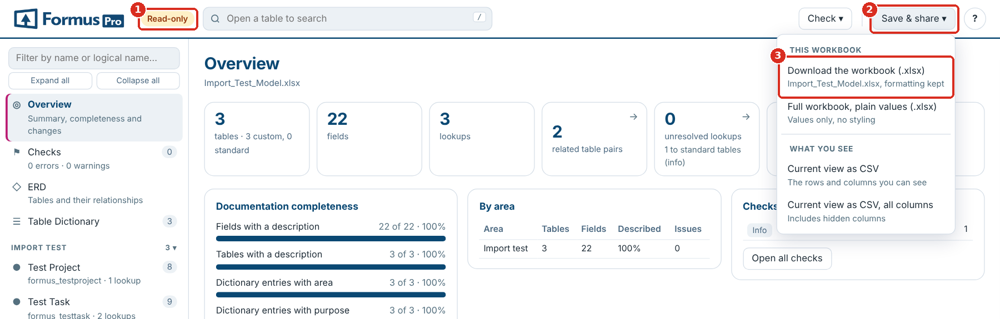

**1** The Read-only label · **2** Save & share · **3** Download the workbook (.xlsx)

In a read-only copy, **Save & share** has **Download the workbook (.xlsx)**: the workbook the copy was made from, with your edits written in and its formatting kept, ready to open in Excel. **Full workbook, plain values** and the CSV exports are there too.

| They can | They can't |
| --- | --- |
| Browse, search and filter every table and field, and use All fields | Edit values, add fields or rows, or change keys and table details |
| Read the Overview and Checks | Change the template |
| Draw the ERD, hide relationships, and export the diagram | Save the workbook or build a solution |
| Run the Dataverse check against their environment | Open a different workbook |
| Download the workbook as Excel (.xlsx), or the current view as CSV | See your other workbooks: the copy keeps nothing in their browser |

The copy is a snapshot. After more edits, make and send a new copy. A developer can also make one from the command line: `python3 build.py --readonly --workbook "<workbook>.xlsx" --out "<name> (read-only).html"`. Never commit a copy built from a client's workbook to the repository.

## Using it inside Dynamics 365

Uploaded to an environment as a web resource, the page reads the environment's tables directly through the Dataverse Web API, signed in as you. Nothing is installed in the environment except the page, nothing is changed, and you see only what your security role lets you see.

### Putting it in an environment

1. Get the solution zip: `FORMUS_DataModelExplorer_5_0_3_0.zip` in the repository, or make one with your publisher: `python3 tools/make-webresource-solution.py --prefix <prefix> --publisher <publisher unique name>`. The publisher unique name must match the one in the environment exactly.
2. Import it into the environment (Power Apps → Solutions → Import, or `pac solution import`). It holds one HTML web resource of about 2.4 MB, under the 5 MB default limit.
3. Open `https://<your-org>.crm.dynamics.com/WebResources/<prefix>_/dme/DataModelExplorer.html`, or add that web resource to an app's navigation.

The page opens on **This environment**, and the header's **Environment** button (or **Check ▾ → This environment**) brings it back. **Workbook ▾ → Load from this environment…** opens it too.

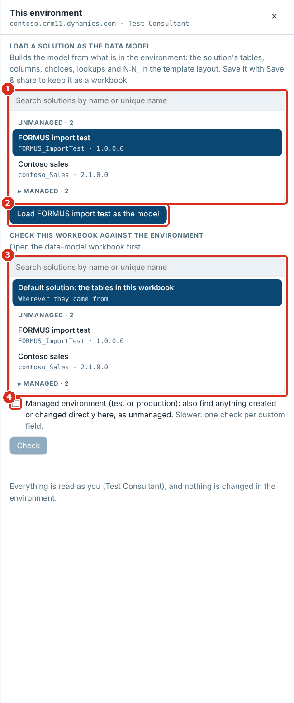

**1** Find and pick a solution · **2** Load it as the model · **3** The solution to check against · **4** Managed environment

### Loading a solution as the data model

1. Find the solution in the list and click it, for example `FORMUS import test`. Type in the search box to find it by name or unique name. Your unmanaged solutions are listed first; managed ones are folded under **Managed** and open when you click it or search.
2. Click **Load … as the model** (the button names the solution). The page reads the solution's tables and, for each one, its columns, types, required levels, choice options, number and text settings, lookups with their cascade, and N:N relationships. Alternate keys are read too and shown on each table page under From Dataverse.
3. The model opens like a workbook, in the template layout, so everything works on it: Checks, the ERD, search and the exports. **Save & share → Rebuilt in the current template** saves it as a workbook to keep or send.

A table added to the solution whole brings all its columns; a standard table such as Contact, added only for the columns you made on it, brings just those columns (plus its key and name). Helper columns Dataverse makes for others (such as the name behind a lookup) are left out.

### Checking the workbook against the environment

1. Open the data-model workbook (the design).
2. Click **Environment**, and under **Check this workbook against the environment** pick what to compare with:
    - **a solution**, which also finds tables in the solution that the workbook doesn't have; or
    - **Default solution: the tables in this workbook**, which reads every table the workbook names, wherever it came from.
3. In a test or production environment, tick **Managed environment** to also find anything created or changed directly there.
4. Click **Check**.

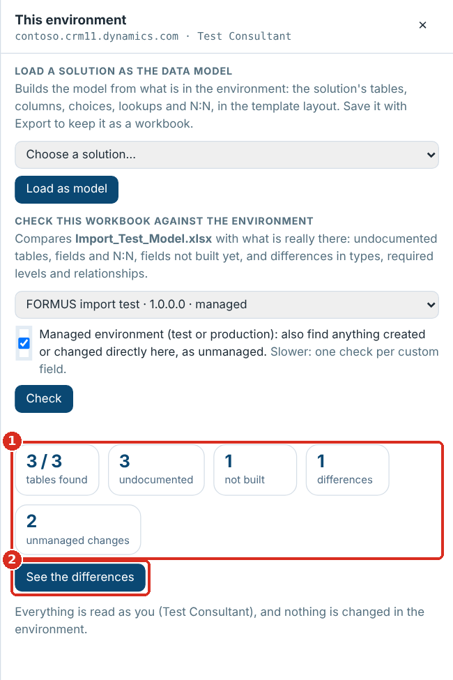

**1** What the check found · **2** See the differences

| Found | Means |
| --- | --- |
| Undocumented | In the environment but not in the workbook: a table in the solution, a custom field, or a custom N:N relationship |
| Not built | In the workbook but not in the environment yet |
| Differences | Built differently: type, required level, ownership, or a lookup's target |
| Unmanaged changes (managed environment only) | Made directly in this environment instead of by a managed solution: a table, field or N:N created there, or a managed table or field changed there. Where Dataverse reports it, the change says which properties were changed |

**See the differences** opens Checks on just these findings. Each opens its table and field, and **Export (CSV)** downloads them.

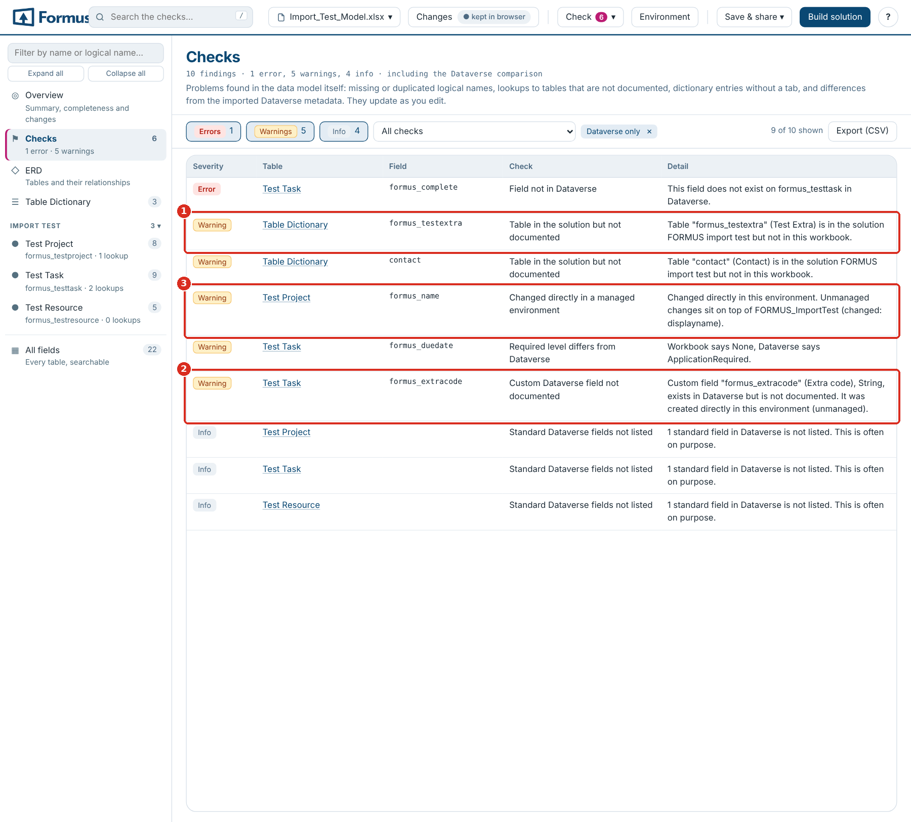

**1** A table in the solution but not in the workbook · **2** A field made directly in the environment · **3** A managed field changed directly in the environment

**Keeping design and build in step.** For new development, start the workbook from the blank template, design in it, build and import the solution as usual, then run the check after each round of development. Undocumented items are what developers added in the environment: add them to the workbook (or remove them from the environment) so the two agree.

**Speed.** Loading a solution makes about a dozen Web API requests per table, eight at a time, so 50 tables take around 10 seconds. The managed-environment check reads one more record per custom field.

## Using it in XrmToolBox

The page also runs as a tool in XrmToolBox. It works exactly as inside Dynamics 365 (Using it inside Dynamics 365), on the environment XrmToolBox is connected to, and nothing needs installing in the environment.

### Installing the tool

Until it is in XrmToolBox's Tool Library, build it from the repository on a Windows machine with the .NET SDK (8 or later):

1. In `data-model-explorer-v5`, run `npm install` and `npm run build`, then copy `dist\Data_Model_Explorer.html` into the folder (the repository already has a copy).
2. Close XrmToolBox.
3. In `data-model-explorer-v5\xrmtoolbox`, run `.\deploy.ps1`. It builds the tool and copies `FormusPro.DataModelExplorer.XrmToolBox.dll` into `%APPDATA%\MscrmTools\XrmToolBox\Plugins` (for a portable XrmToolBox: `.\deploy.ps1 -Plugins <its Plugins folder>`).
4. Start XrmToolBox and open **Data Model Explorer** from the tool list.

### Using the tool

1. Connect to an environment as usual. The tool asks for a connection if there is none.
2. The page opens on **This environment**: load a solution as the model, or open a workbook and check it against the environment.
3. Connecting to another environment (the connection button in XrmToolBox's toolbar) reopens the page on that one.

The page reads the environment with XrmToolBox's sign-in, as the connected user, and only reads: the tool passes on read requests and refuses anything else. Workbooks, edits and ERD layouts are kept for the next session, in XrmToolBox's settings folder. Downloads go to your Downloads folder.

It needs the Microsoft Edge WebView2 Runtime (part of Windows 10 and 11) and a connection that signs in with Microsoft 365 (OAuth), a client secret or a certificate. Older on-premises connection types don't give the tool a token: the page still opens, but can't read the environment.

## Updating the template

The template sets which columns and table details every workbook has, the dropdown options, and the look of **Rebuilt in the current template**. The page has the current FormusPro template built in; you can replace it with your own.

### Checking a workbook against the template

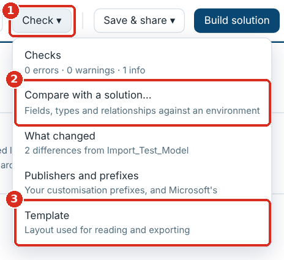

**1** Check ▾ · **2** Compare with a solution… · **3** Template

Click **Check ▾ → Template**. The panel lists tables not in the template, extra columns the workbook has, and columns or details it is missing. A pink count on the button shows how many tables differ.

### Bringing an older workbook up to date

1. Open the workbook. Columns and table details it lacks (for example Relationship Type, Cascade Delete, Primary Name Column) are added in the page and marked **added**.
2. Fill them in where you need them.
3. Save it one of two ways:
    - **Save** or **Save as…**: only the added columns you filled in are written, with their headers and hints.
    - **Rebuilt in the current template**: the whole workbook rebuilt in the current template layout, every column and detail included.

### Using your own template

1. **Check ▾ → Template → Download blank template** to start from the current one.
2. Change it in Excel and keep the layout: the Table Dictionary, and one example table tab with its detail rows, hint row and header row starting `Logical Name`, `Schema Name`.
3. **Template → Use a different template…** and pick your file. The page remembers it in this browser; **Reset to bundled** goes back to the built-in one.
4. Reopen the workbook (or reload the page) so it picks up the new columns.

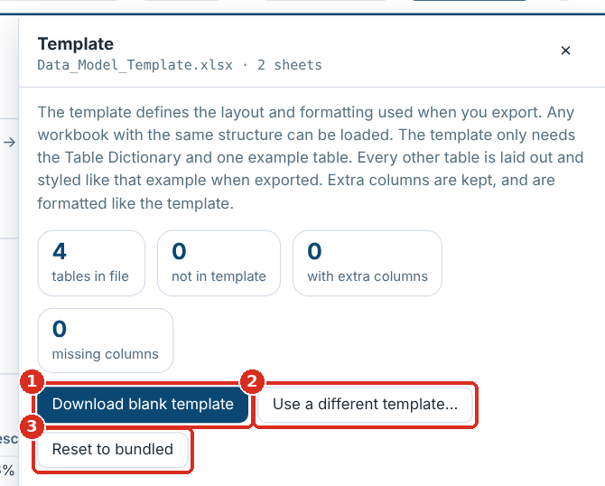

**1** Download blank template · **2** Use a different template… · **3** Reset to bundled

### What you can change

| Change in the template | Effect in the page |
| --- | --- |
| A new column in the header row | Read, shown, filterable and editable; added to workbooks that lack it |
| Text in the hint row above a column | Shown as the column's tooltip and written with the column |
| An Excel data-validation list on a column | Its options become the column's dropdown |
| A new label row in the table details | Shown in **✎ Table details** and added to tables that lack it |
| Fonts, colours, widths | Used by **Rebuilt in the current template** |

A new column needs a code change only if the solution builder or a check should use it.

## Comparing with a solution

Opened as a file, the page checks the workbook against a solution exported from Power Apps: its tables, fields (types, required levels, custom or standard), relationships with their cascade settings, N:N and alternate keys. Nothing is uploaded: the file is read in the browser. Inside Dynamics 365 or XrmToolBox, the same panel picks a solution straight from the environment instead (Using it inside Dynamics 365).

1. In Power Apps, open **Solutions**, select the solution and choose **Export** (managed or unmanaged).
2. Click **Compare with a solution…** on the Overview, or **Check ▾ → Compare with a solution…**.
3. Click **Add a solution (.zip)…** and pick the exported file, or drop it onto the page. Several can be added at once; a solution built with **Build solution** works too.
4. Click **See the differences**: the Dataverse checks appear in **Checks**, and each table page shows what the solution has.

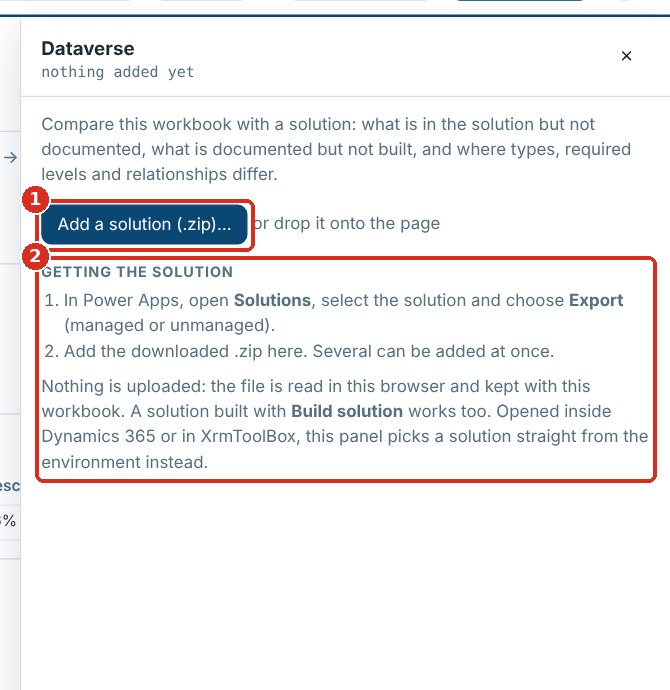

**1** Add a solution (.zip)… · **2** How to export one from Power Apps

Only your own tables are expected in the solution: a standard table such as Account that it doesn't hold is not flagged. A table included in the solution as a shell (only the columns you added) is compared on those columns, so its other standard columns are not reported missing. The comparison is kept in the browser for this workbook; **Remove** forgets it.

| Dataverse check | Means |
| --- | --- |
| Field not in Dataverse | The workbook has it, the solution doesn't (yet) |
| Attribute type or required level differs | Workbook and solution disagree |
| Dataverse relationship not documented; custom Dataverse field not documented; table in the solution but not documented | The solution has it, the workbook doesn't |
| Table not in the Dataverse metadata | One of your tables is not in the solution |

## Publishers and prefixes

**Check ▾ → Publishers and prefixes** lists your customisation prefixes and the publisher each belongs to: the prefix (for example `cxp`, `ax` or `portal`), the publisher's unique name, its display name and its choice value prefix. They are kept in this browser for every workbook.

- **Checks** count a field as yours when it starts with one of your prefixes, and flag a custom field whose prefix is neither yours nor Microsoft's.
- **＋ Add field** gives a new field the table's own prefix, or your usual one.
- **Build solution** suggests your prefixes in its Prefix box and fills in that prefix's publisher. Building with a new prefix adds it to the list.
- **Microsoft and other vendors' prefixes** are treated as out of the box. The default is `ms*, adx`: an entry ending in `*` matches every prefix that starts with it, so `ms*` covers `msdyn`, `mspp`, `msdynce` and the rest. Add any others you use, such as a partner's.
- Prefixes used in the workbook that are not listed appear under the table, to add with one click. **Reset** goes back to guessing your prefixes from the custom tables, as before.

## Generating a Dataverse solution

**Build solution** in the header (or **Build solution…** on the Overview, or **Save & share → Dataverse solution (.zip)…**) turns the workbook into an unmanaged solution, so nothing is created by hand in Power Apps. Clear the errors in Checks first.

1. Choose **What to build**: **Tables, fields and relationships** (everything with your prefix), or **Tables only**, which builds each new table with just its primary name column, for when you want the tables in place first and the fields later. The choice is remembered for the workbook.
2. Fill in the rest of the dialog. The prefix and choice value prefix are suggested from the workbook.
3. Read **Will be built**: new tables, existing tables gaining your fields, fields and relationships, plus what is to build by hand or not included and why.
4. Click **Generate**. One zip downloads: `<SolutionName>_<version> build.zip`.

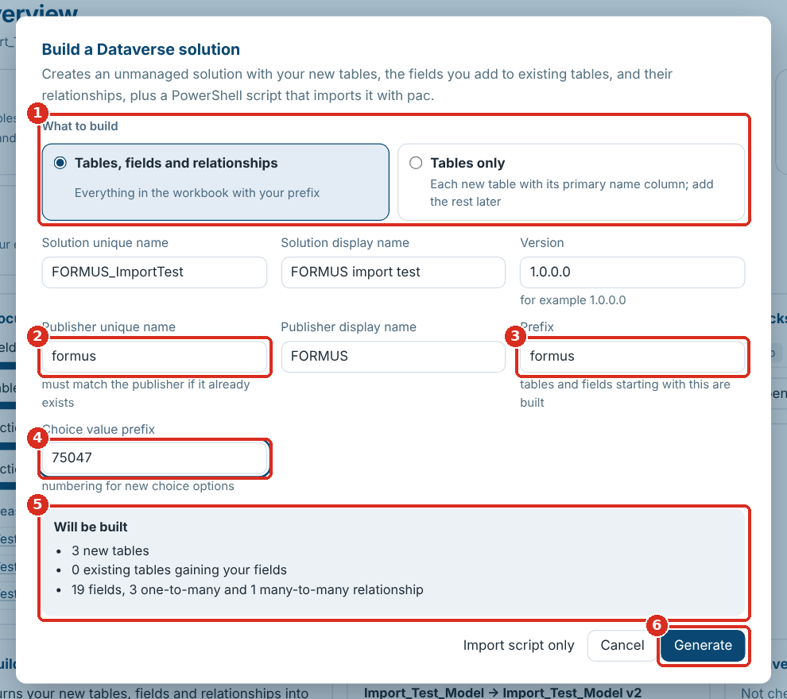

**1** What to build · **2** Publisher unique name · **3** Prefix · **4** Choice value prefix · **5** Will be built · **6** Generate

| Field | What to enter |
| --- | --- |
| Solution unique name, display name | For example `FORMUS_DataModel`, `FORMUS data model` |
| Version | Four numbers, for example `1.0.0.0`; raise it for each new import |
| Publisher unique name | **Exactly** the unique name of the publisher already in the environment (Power Apps → Solutions → Publishers → Name). A different name creates a second publisher |
| Publisher display name | Used only if the publisher is new |
| Prefix | Your publisher prefix, for example `formus`. Tables and fields starting with it are built |
| Choice value prefix | Your publisher's option value prefix, for example `75047` |

**What is built:** every new table with your prefix, with its primary name column, primary key, ownership, notes and audit settings, and its fields; your fields on standard tables such as Contact, without changing anything else about those tables; a relationship for every lookup and customer lookup, with its cascade setting; every N:N relationship. Text length and format, number ranges and precision, currency precision, date format, Yes/No labels, choice options and values, defaults, required level and field security carry over.

**Not built** (listed in the build report instead): calculated and rollup fields, prefixed copies of system fields (such as `fp_createdon`: Dataverse creates `createdon` on every table), activity tables, lookups to several tables, image and file fields, choice fields with no options, tables with no primary name column or a primary key that isn't a unique identifier, forms and views.

| In the download | What it is |
| --- | --- |
| `<SolutionName>_<version>.zip` | The unmanaged solution |
| `import.ps1` | Imports it with the Power Platform CLI |
| `build-report.csv` | Every table, field and relationship: included, not included (with the reason) or to build by hand |
| `calculated-and-rollup-fields.xlsx` | The fields to create by hand, per table, with a column for the formula |
| `README.txt` | These steps |

## Importing the solution

You need PowerShell (7, or Windows PowerShell 5.1) and the System Customizer or System Administrator role. Always import into a **development** environment first.

1. Unzip the build into a folder.
2. Open PowerShell in that folder and run:

    ```powershell
    .\import.ps1 -EnvironmentUrl https://yourorg.crm11.dynamics.com
    ```

3. If the Power Platform CLI (`pac`) is missing, the script installs it (with the .NET SDK, or winget on Windows).
4. A browser window opens: sign in.
5. The script imports the solution and publishes it. A large model can take several minutes.

| Option | Does |
| --- | --- |
| `-Check` | Runs Microsoft's solution checker first; results go in a `check-results` folder |
| `-SolutionPath .\Other.zip` | Imports that zip instead of the one beside the script |

If Windows refuses to run the downloaded script, run `Unblock-File .\import.ps1` once. **Save & share → Import script (import.ps1)** downloads the script on its own, to import a solution zip you already have.

## After the import

1. Open `build-report.csv` and deal with anything marked **Not included**.
2. Create the fields in `calculated-and-rollup-fields.xlsx` in Power Apps, with their formulas.
3. For tables with **Has Activities** set, turn on Activities in the table's properties.
4. Lay out forms and views.
5. Optionally, compare the workbook with the environment (Comparing with a solution) to confirm everything landed.
6. Export the solution from development as **managed** for test and production.

## Troubleshooting and FAQ

| Problem or question | What to do |
| --- | --- |
| A table shows in the page that isn't in my workbook | You are looking at a different workbook kept in the browser: pick yours in the workbook selector, or **Manage files… → Remove all…** |
| My edits disappeared after opening a file | You opened it as a **different workbook**, which has its own edits. Switch back in the workbook selector |
| Saving was stopped and nothing was saved | Read the reason it gives. Usually there is no empty row for an added field before the Forms section, or a sheet that rows can't be inserted into (it holds an Excel table, a drawing or comments, or a pivot table reads from it). Use **Rebuilt in the current template**, or add empty rows in Excel and reload |
| **Save** asks where to save every time | The page isn't linked to a file: in Firefox and Safari it can't be, so Save downloads. In Chrome and Edge, open the file with Open workbook… (not by dragging it), or save once and it is linked from then on |
| A lookup shows a plain grey line in the ERD and "relationship type not recorded" | Set Relationship Type to `N:1` on that lookup once confirmed |
| A line is missing from the ERD | Its row may be hidden: look for a faded row with a crossed-out eye and click the eye, or click **show all** in the side panel |
| A client or support team needs to see the model | Send a read-only copy (Sharing a read-only copy) |
| The Environment button isn't there | The page only reads an environment when it is opened from that environment, as a web resource (Using it inside Dynamics 365), or in XrmToolBox |
| In XrmToolBox: "This connection does not give an access token" | Connect with Microsoft 365 sign-in (OAuth), a client secret or a certificate |
| In XrmToolBox: the tool says it needs the WebView2 Runtime | Install the Microsoft Edge WebView2 Runtime and open the tool again |
| "Not allowed (HTTP 403)" in This environment | Your security role can't read table definitions or solutions. Ask an administrator for a role that can |
| "Solution layers could not be read" | The managed-environment check couldn't read solution layers, so changes to managed fields aren't shown. Unmanaged tables and fields still are |
| A read-only copy won't open my workbook | It only shows the workbook inside it. Make a new copy from the full page |
| Where did Export, More and Load version go? | 4.0 regrouped them: Export is **Save & share**, More is **Check**, Load version is in the **Workbook** menu, and Dataverse solution is **Build solution** |
| **Build solution** is greyed out | No workbook is open yet: open one first |
| A table is "Not included": no Primary Name Column | Open a text field in that table and click **Set as primary name** |
| A field is "Not included": choice field with no options | Add `Options:` and its values to Additional data |
| The import created a second publisher | The publisher unique name didn't match the environment's. Generate again with the exact name, import, and remove the extra publisher once nothing uses it |
| Windows refuses to run `import.ps1` | Run `Unblock-File .\import.ps1`, or start PowerShell with `-ExecutionPolicy Bypass` for that session |
| `pac` was installed but the script says it isn't available | Open a new PowerShell window and run the script again |
| The import failed | The message from `import.ps1` says why, and nothing was changed. Fix the workbook, raise the version, generate and import again; send the message to the tool's maintainer if it names the solution file |
| Can I share the HTML file? | Yes. The full page holds only the empty template; your workbooks and edits stay in your browser. A read-only copy holds the workbook you made it from |
| Is anything uploaded? | No. Everything runs in the browser; the Dataverse links are opened by you |
| Can the primary key be a text field? | Not in Dataverse: keys are unique identifiers. Use an alternate key to keep another field unique |

## Reference: the workbook layout

The page reads workbooks in the FormusPro data-model template: one **Table Dictionary** sheet plus one tab per table. **Download blank template** under Start here, or **Check ▾ → Template → Download blank template**, gives you an empty copy.

**Table Dictionary.** One row per table: Area, Table Name, Out of the box/custom table?, Static Data?, Purpose, FormusPro Comments, Added to ERD?, Defined in data model?. The **Area** groups tables in the sidebar, the filters and the ERD.

**Table details.** Label and value rows at the top of each table tab, in columns A and B:

| Row | What to put |
| --- | --- |
| Entity, Plural Display Name, Description | The table's display names and description |
| Schema Name, Logical Name | For example `formus_Need`, `formus_need` |
| Object Type Code, Is Custom Entity, Ownership Type, Audit Tracking | As in Dataverse (`UserOwned` or `OrganizationOwned`; `True` or `False`) |
| Primary Name Column | The table's name field, for example `formus_name`. Needed to build a new table |
| Primary Key | The table's ID field, for example `formus_needid` |
| Is Activity, Has Notes, Has Activities | `True` or `False` |

**Field list.** Below the details, a hint row and a header row starting `Logical Name`, `Schema Name`, then one row per field:

| Column | What to put |
| --- | --- |
| Logical Name, Schema Name, Display Name | The field's names |
| Attribute Type | Text, Multiline Text, Whole number, Decimal, Double, Currency, DateTime, Two options, Choice, Choices, Lookup, Customer, Uniqueidentifier |
| Description | What the field holds |
| Custom Attribute | `True` for your own fields |
| Type | `Simple`, `Calculated` or `Rollup` |
| Required Level | `None`, `Recommended` or `ApplicationRequired` |
| Additional data | Settings, one per line (below) |
| Add to RAF Form?, Comment | Free text |
| Relationship Type | `N:1` on a lookup; `N:N` on a row that describes a many-to-many relationship |
| Relationship Name | Optional: generated if blank. Hidden in the page by default |
| Cascade Delete | `Remove Link` (default), `Restrict` or `Cascade` |

**Additional data.** One setting per line, as the Metadata Document Generator writes them:

- Text: `Format: Text` (or Email, Url, Phone, TextArea) and `Max length: 200`
- Numbers and currency: `Minimum value: 0`, `Maximum value: 1000`, `Precision: 2`
- Dates: `Format: DateOnly` or `Format: DateAndTime`
- Two options: `True: Yes`, `False: No`, `Default Value: False`
- Choice and Choices: `Options:` then one `value: label` per line, for example `750470000: Planned`, and `Default: 750470000`
- Lookup and N:N: `Targets:` then the other table's logical name

**Many-to-many relationships.** Add a row whose Logical Name is the relationship name (for example `formus_project_resource`), Relationship Type `N:N`, and `Targets: formus_resource` in Additional data.

**Forms and Views.** Rows starting `Forms:` and `Views:` below the field list are read and shown under the field list; they are not built in Dataverse.

**Sub-grids.** A row in the field list whose Attribute Type is `Sub grid` documents a sub-grid on a form. It needs no logical name, and it is not checked, counted as a field or built.

**Older workbooks.** Columns and table details the template has but your workbook lacks (for example Relationship Type) are added in the page, marked **added**, and written to the file with the first value you save in them. A column you add to the template's header row is read, shown, filterable and editable too.
