## Introduction

The Data Model Explorer is one HTML file that opens a Dataverse data-model workbook, checks it, lets you edit it, and turns it into a Dataverse solution you import with one script. It runs entirely in Chrome or Edge: nothing to install, it works offline, and the workbook never leaves your machine.

It is for anyone who owns or reviews a data model kept in the FormusPro template: functional consultants, solution architects and developers.

| Job | What you do in the page |
| --- | --- |
| Review | See the size and completeness of the model, search every field, run the automatic checks, draw the ERD |
| Edit | Change values, add fields, lookups and many-to-many relationships, set primary keys and table details |
| Compare | Load a newer version of the workbook, see every difference, and keep your edits |
| Build | Generate an unmanaged Dataverse solution, then import it with `import.ps1` |

This guide describes version 1.9.1. The latest file is in the SharePointPCF repository under `data-model-explorer`.

## Opening (uploading) a workbook

Double-click `Data_Model_Explorer.html` to open it in Chrome or Edge, then open your workbook. The first time, the page shows the empty template and says so.

1. Click **Open workbook…** in the header, or drag the `.xlsx` file onto the page.
2. A workbook in the template layout opens straight away. A **Metadata Document Generator export** is converted to the template layout first; a progress window shows the tables and fields converted. The converted file keeps the export's name.
3. The page opens on the **Overview**. Tables are listed in the sidebar, grouped by area when the Table Dictionary has areas.

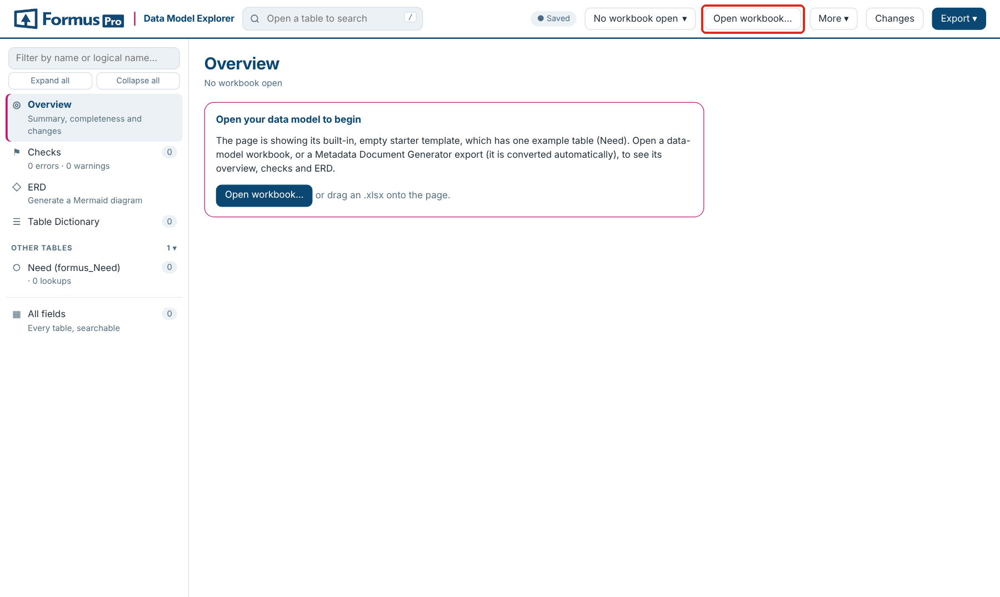

**Browsers.** Chrome or Edge. Saving back to the original file uses a feature only those browsers have; everything else also works in other modern browsers.

## Switching between workbooks

**Opening a second file.** When a workbook with edits is open, the page asks whether the new file is a **newer version of the same workbook** (your edits carry over and the differences are shown) or a **different workbook** (it gets its own, separate set of edits).

**The workbook selector.** The button with the workbook's name in the header lists every workbook kept in this browser; pick one to switch. **Manage files…** in the same menu shows them all, and **Remove all…** there clears them.

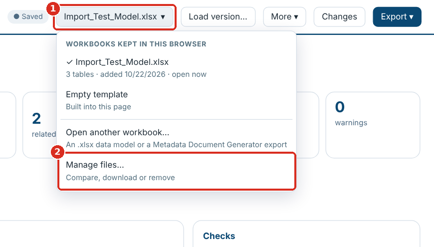

**1** The workbook selector · **2** Manage files…


**Where things are kept.** Open workbooks are stored in the browser (IndexedDB) and your edits, column choices and ERD layouts in local storage, for this browser profile only. They are not in the HTML file, so anyone you send the file to starts with just the empty template. The **Saved** label in the header confirms edits are stored; if the browser refuses to store them it says so.

## Loading a new version

Click **Load version…** (or drop the new file on the page) and choose **newer version** when asked.

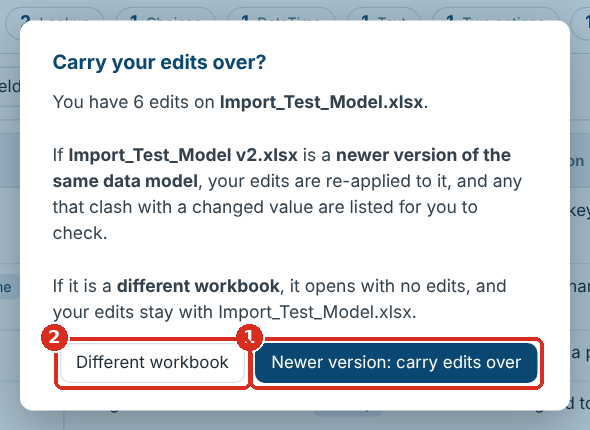

**1** Newer version: carry edits over · **2** Different workbook: a separate set of edits

- **What changed** opens with every difference: tables and fields added or removed, values changed, columns added or removed, table details, forms and views, and lookup targets. **Version differences (CSV)** in the Export menu downloads them. Tables are matched by tab name, fields by Logical Name, so row order doesn't matter.
- Your edits are re-applied. Where the new version changed a value you had edited, it is listed under **Needs your attention** in Changes: choose **Keep mine** or **Use new version**. An edit to a field the new version no longer has can be discarded there.
- Rows you added are carried over too. If the new version already has a field with the same logical name, you choose whether to keep the new version's or add yours as well.

## The Overview

The Overview is the landing page: it sizes the model, shows how complete it is, and links to what needs attention. Click **Overview** in the sidebar to come back to it.

| Card | What it shows |
| --- | --- |
| Counts across the top | Tables (custom and standard), fields, lookups, related table pairs, unresolved lookups, errors, warnings and your edits. Most cards open the matching list when clicked |
| Documentation completeness | Share of fields and tables with a description, dictionary entries with an area and a purpose, and the least described tables |
| By area | Tables, fields, how much is described and the number of issues, per area |
| Checks | The findings by check and severity, each linking to the full list |
| Build a Dataverse solution | Opens the solution builder |
| Latest changes | Your recent edits, or the differences from the previous version |
| Dataverse check | Whether the workbook has been compared with a Dataverse environment, and a button to start |

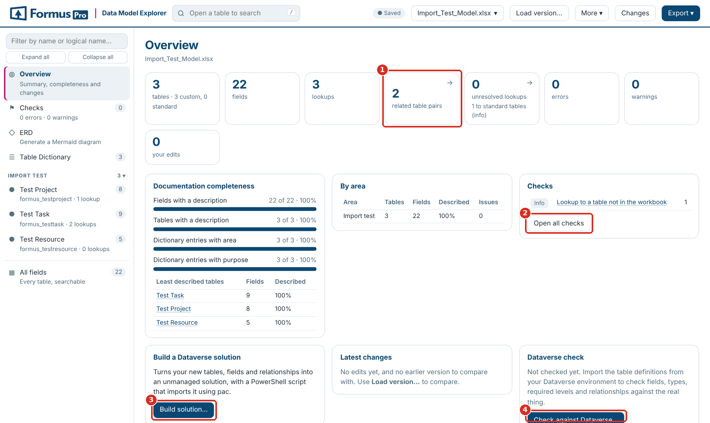

**1** Count cards open their list · **2** Open all checks · **3** Build solution… · **4** Check against Dataverse…

When the page reopens a workbook from last time, the Overview says which one, so you can switch if it is not the one you want.

## Checks

**Checks** runs over the whole model and updates as you edit; clear the errors before you build a solution. Each finding names the table and field and opens it when clicked.

| Check | Severity | How to fix it |
| --- | --- | --- |
| No primary name column | Error | Set Primary Name Column in the table details (Set as primary name on a text field) |
| Primary name column not in the field list | Error | Add the field, or point Primary Name Column at an existing one |
| Primary name column is not single-line text | Error | Choose a Text field as the primary name |
| Primary key is not a unique identifier | Error | Leave Primary Key as the table name followed by `id`; use an alternate key for other unique fields |
| Table or field without a logical name | Error | Fill in Logical Name |
| Duplicate field, or same table on more than one tab | Error | Remove or rename the duplicate |
| Relationship name used twice | Error | Change one Relationship Name, or leave it blank to generate one |
| No attribute type | Warning | Fill in Attribute Type |
| Lookup without targets | Warning | Add `Targets:` and the table to Additional data |
| Lookup to a table not in the workbook | Warning | Add the table's tab, or check the logical name |
| Relationship type not valid here; Cascade Delete not recognised | Warning | Use `N:1` on a lookup, `N:N` on a relationship row; `Remove Link`, `Restrict` or `Cascade` |
| N:N relationship with an unknown table | Warning | Put exactly one table in `Targets:` |
| Dictionary entry with no tab; table missing from the dictionary | Warning | Match the Table Dictionary to the tabs |
| Relationship type not recorded | Info | Set Relationship Type to `N:1` on lookups you have confirmed |
| Calculated or rollup field to create by hand | Info | Nothing to fix: listed for after the import |
| Logical name format; custom field without a publisher prefix; no primary key field listed | Info | Usually Microsoft's own fields; check your own |

Checks starting "Dataverse" appear only after you load Dataverse metadata (see Comparing with Dataverse).

Use the **Errors**, **Warnings** and **Info** buttons (with their counts) to show or hide each severity, the **Area** filter to narrow the list, and the search box to find a table or field. **Export (CSV)** downloads the list.


**1** Errors · **2** Warnings · **3** Info · **4** Export (CSV)

## The ERD

The **ERD** draws the tables you pick, joined by their lookups and N:N relationships, so the diagram always matches the workbook.

1. Pick tables in the list on the left: tick them one by one, filter by name or area and use **Select shown**, or use **Custom only**, **All** and **None**.
2. Click ★ next to a table to make it a **core table**: the diagram is laid out around it, and with **Selecting a table also selects the tables it relates to** on, its neighbours come too.
3. Choose what each box shows (**Names only**, **Keys + lookups** or **All fields**), the **Direction** (left to right or top to bottom), and when relationship names show.
4. Drag tables to tidy the layout; **Auto layout** starts again. Layouts are remembered per selection.

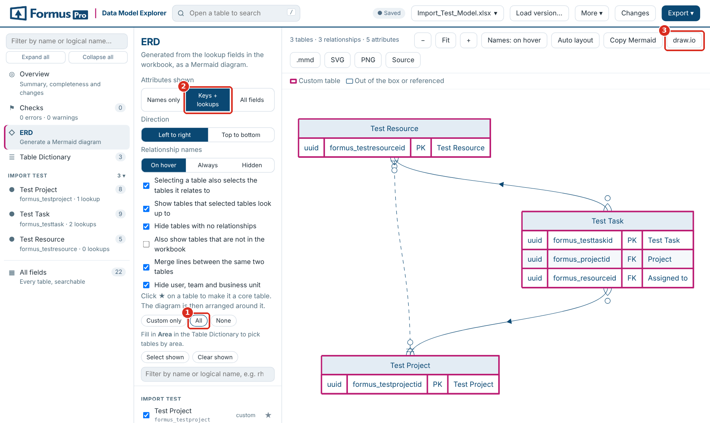

**1** All tables · **2** Keys + lookups · **3** Export to draw.io

**Reading the lines.** A line shows its ends (one or many) only where the relationship type is recorded in the workbook. A relationship whose type isn't recorded is drawn as a plain grey line and listed in Checks for review; N:N relationships are dashed. Custom tables have a pink border; standard tables and tables referenced but not in the workbook have a plain one.

**Options.** Show tables that selected tables look up to; hide tables with no relationships; also show tables that are not in the workbook; merge lines between the same two tables; hide user, team and business unit.

**Exports.** **draw.io** (an editable diagram), **SVG**, **PNG**, **.mmd** and **Copy Mermaid** (the Mermaid source). With many tables, draw a few dozen at a time: a whole large model is slow to lay out and hard to read.

## Browsing and searching tables

Every table tab is a page: its details along the top, counts by field type, and the field list. **All fields** in the sidebar lists every field of every table in one searchable view.

- **Sidebar.** Tables grouped by area, with their field and lookup counts. Type in the box at the top to filter by name or logical name.
- **Search.** The box in the header (shortcut `/`) searches the open table, or every field in **All fields**.
- **Column filters.** The funnel icon on any column header filters by its values. Active filters show above the grid with a × to clear each one.
- **Quick filters.** **Edited only** shows rows you have changed; **Area** (in All fields) limits the list to areas; the counts by field type filter to that type when clicked.
- **Columns ▾** shows or hides columns. Schema Name, Type and Relationship Name are hidden by default.
- **Expand / Collapse all rows** switches between full text and two-line rows; the ▾ on a row does it for that row.

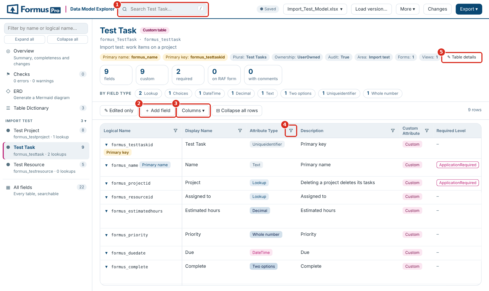

**1** Search · **2** ＋ Add field · **3** Columns ▾ · **4** Column filter · **5** ✎ Table details

## Editing values

- **Double-click a cell** to edit it, or click a row to open its panel on the right and click a value there. `Enter` saves, `Esc` cancels, `Shift`+`Enter` starts a new line in long text.
- Columns with a fixed set of values (Attribute Type, Required Level, Relationship Type, Cascade Delete and similar) edit as a **dropdown**; **＋ New value…** adds one.
- Edited cells are highlighted. The row panel shows the original value with **revert**, and the **Changes** button lists every edit.
- In the row panel, `j` and `k` (or ↑ ↓) move to the next and previous row.


## Adding fields and relationships

**＋ Add field** on a table page adds a row at the end of its field list.

1. Choose **A field** or **An N:N relationship**.
2. Type the **Display name**. The **Logical name** and **Schema name** are suggested with your prefix (`Actual hours` becomes `formus_actualhours` and `formus_ActualHours`); type over them if you need to.
3. Pick the **Field type**. For a **Lookup** or an **N:N**, pick the **Related table**; the page fills in `Targets:` and the Relationship Type (`N:1` or `N:N`).
4. Click **Add**. The new row is tagged **ADDED** and opens on the right for everything else: choice options, length, format, cascade.

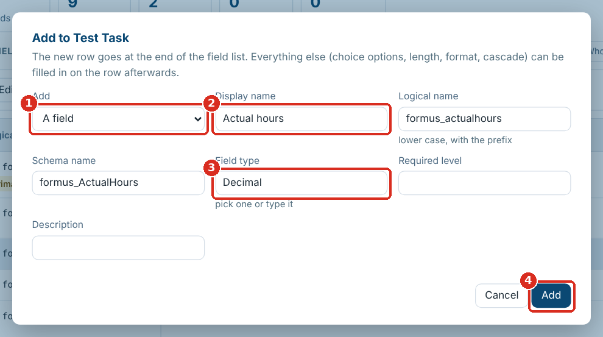

**1** A field or an N:N relationship · **2** Display name (the names follow it) · **3** Field type · **4** Add

A name already in the table is refused. To remove an added row, click **Remove row** in its panel, or **remove** under **Rows added** in Changes. On other sheets, such as the Table Dictionary, **＋ Add row** adds a blank row.

## Primary key, primary name and table details

- The table header shows the **Primary name** and **Primary key**. When the workbook doesn't record the key, it shows the table name followed by `id`, marked **(assumed)**; a missing primary name shows as **not set**.
- In the field list, those two fields are tagged **Primary key** and **Primary name**.
- To change them, open a field and click **Set as primary key** or **Set as primary name**. The primary name must be single-line text.
- **✎ Table details** in the header edits every detail row (ownership, notes, activities and the rest), including details the template has but the table lacks.

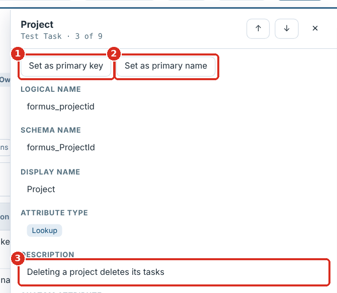

**1** Set as primary key · **2** Set as primary name · **3** Click a value to edit it

Dataverse primary keys are always unique identifiers (GUIDs) created with the table. Marking a text or number field as the key is flagged in Checks; to keep another field's values unique, use an alternate key in Dataverse.

## Reviewing and undoing your changes

**Changes** in the header lists rows you added, table details you changed, and every cell edit as original against new, each with **go** and **revert**. **Revert all** undoes everything; **Export log (CSV)** downloads the list.

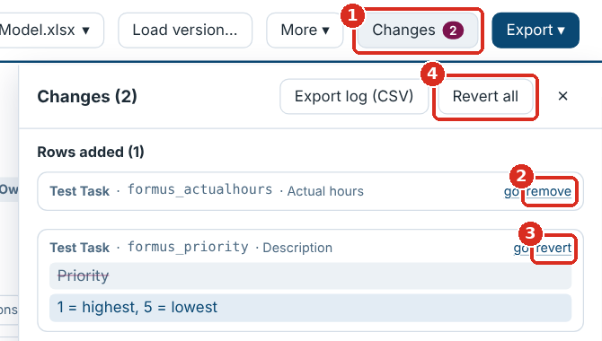

**1** Changes · **2** Remove an added row · **3** Revert one edit · **4** Revert all

## Saving and exporting

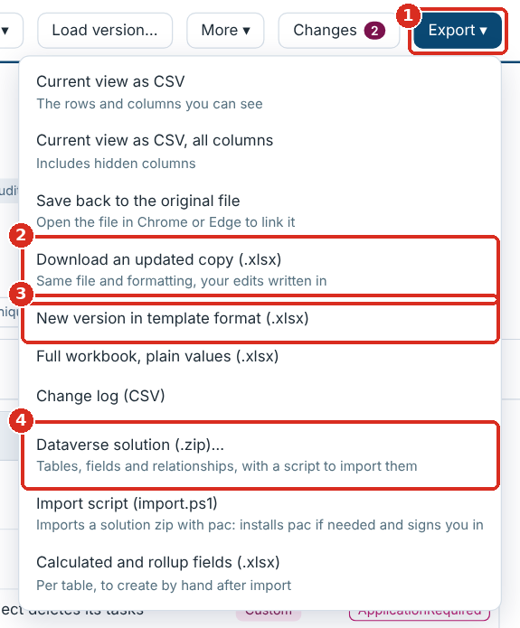

**1** Export ▾ · **2** Download an updated copy · **3** New version in template format · **4** Dataverse solution

| Export menu item | What you get |
| --- | --- |
| Save back to the original file | Writes your edits into the file on disk. Available when the file was opened with the Open workbook… or Load version… button in Chrome or Edge |
| Download an updated copy (.xlsx) | The same file and formatting with your edits written in |
| New version in template format (.xlsx) | The whole workbook laid out and styled by the template, with a Change log sheet |
| Full workbook, plain values (.xlsx) | Values only, no styling |
| Current view as CSV / all columns | The rows you can see, with the visible columns or all of them |
| Change log (CSV) | Your edits |

The first two only rewrite the cells you changed; formatting, validations and everything else stay byte for byte. Added rows go into the empty rows after the field list and new table details into empty rows above it, so nothing moves. The file is then read back and every edit checked. If any edit can't be written (for example there is no empty row left before the Forms section), **nothing is saved**, the reason is shown, and your edits are kept: use **New version in template format** instead.

Every workbook download asks for a file name first, suggesting the next version: `Model v1.2` becomes `Model v1.3`, `Model 1.4` becomes `Model 1.5`, and other names get `(updated)` or `(edited)`.


**1** Type the name · **2** Download

## Updating the template

The template sets which columns and table details every workbook has, the dropdown options, and the look of **New version in template format**. The page has the current FormusPro template built in; you can replace it with your own.

### Checking a workbook against the template

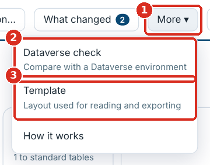

**1** More ▾ · **2** Dataverse check · **3** Template


Click **More ▾ → Template**. The panel lists tables not in the template, extra columns the workbook has, and columns or details it is missing. A pink count on the button shows how many tables differ.

### Bringing an older workbook up to date

1. Open the workbook. Columns and table details it lacks (for example Relationship Type, Cascade Delete, Primary Name Column) are added in the page and marked **added**.
2. Fill them in where you need them.
3. Save it one of two ways:
    - **Download an updated copy** or **Save back to the original file**: only the added columns you filled in are written, with their headers and hints.
    - **New version in template format**: the whole workbook rebuilt in the current template layout, every column and detail included.

### Using your own template

1. **More ▾ → Template → Download blank template** to start from the current one.
2. Change it in Excel and keep the layout: the Table Dictionary, and one example table tab with its detail rows, hint row and header row starting `Logical Name`, `Schema Name`.
3. **Template → Use a different template…** and pick your file. The page remembers it in this browser; **Reset to bundled** goes back to the built-in one.
4. Reopen the workbook (or reload the page) so it picks up the new columns.

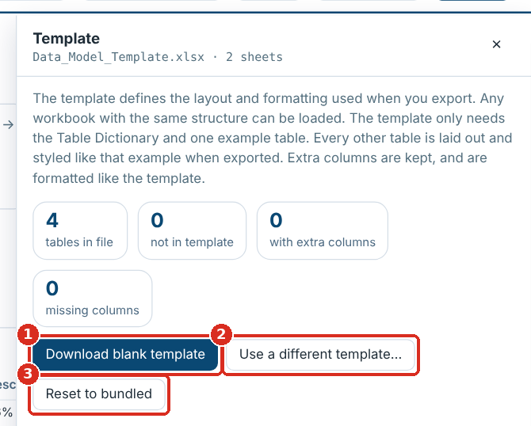

**1** Download blank template · **2** Use a different template… · **3** Reset to bundled

### What you can change

| Change in the template | Effect in the page |
| --- | --- |
| A new column in the header row | Read, shown, filterable and editable; added to workbooks that lack it |
| Text in the hint row above a column | Shown as the column's tooltip and written with the column |
| An Excel data-validation list on a column | Its options become the column's dropdown |
| A new label row in the table details | Shown in **✎ Table details** and added to tables that lack it |
| Fonts, colours, widths | Used by **New version in template format** |

A new column needs a code change only if the solution builder or a check should use it.

## Comparing with Dataverse

The page can check the workbook against the real table definitions in a Dataverse environment: fields, types, required levels, relationships (with N:N and cascade settings) and alternate keys. It stays offline: you open the links yourself while signed in, save what they return, and load the files.

1. Click **Check against Dataverse…** on the Overview, or **More ▾ → Dataverse check**.
2. Enter the **environment URL**, for example `https://yourorg.crm11.dynamics.com`. The page builds one link per 20 tables.
3. Open each link in the browser where you are signed in to Dataverse, and save the page (`Ctrl`+`S`) as a `.json` file.
4. Click **Choose JSON files…** (or drop them onto the page). You can load several, and add more later.
5. Click **See the differences**: the Dataverse checks appear in **Checks**, and each table page shows what Dataverse has.

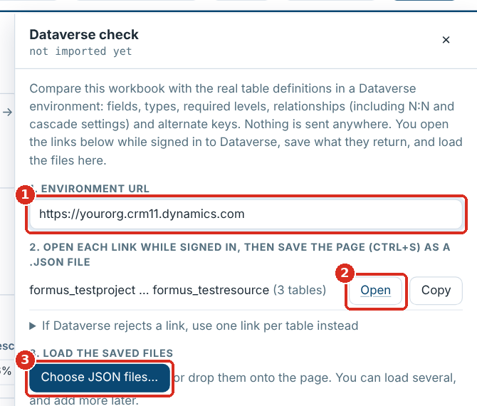

**1** Environment URL · **2** Open each link · **3** Choose JSON files…

If Dataverse rejects a link (usually a very long one), use the one-link-per-table list instead. The metadata is kept in the browser for this workbook; **Remove imported metadata** forgets it.

| Dataverse check | Means |
| --- | --- |
| Field not in Dataverse; relationship not in Dataverse | The workbook has it, the environment doesn't (yet) |
| Attribute type or required level differs | Workbook and environment disagree |
| Dataverse relationship not documented; custom Dataverse field not documented | The environment has it, the workbook doesn't |
| Table not in the Dataverse metadata | No definition loaded for that table |

## Generating a Dataverse solution

**Export → Dataverse solution (.zip)…** (or **Build solution…** on the Overview) turns the workbook into an unmanaged solution, so nothing is created by hand in Power Apps. Clear the errors in Checks first.

1. Fill in the dialog. The prefix and choice value prefix are suggested from the workbook.
2. Read **Will be built**: new tables, existing tables gaining your fields, fields and relationships, plus what is to build by hand or not included and why.
3. Click **Generate**. One zip downloads: `<SolutionName>_<version> build.zip`.


**1** Publisher unique name · **2** Prefix · **3** Choice value prefix · **4** Will be built · **5** Generate

| Field | What to enter |
| --- | --- |
| Solution unique name, display name | For example `FORMUS_DataModel`, `FORMUS data model` |
| Version | Four numbers, for example `1.0.0.0`; raise it for each new import |
| Publisher unique name | **Exactly** the unique name of the publisher already in the environment (Power Apps → Solutions → Publishers → Name). A different name creates a second publisher |
| Publisher display name | Used only if the publisher is new |
| Prefix | Your publisher prefix, for example `formus`. Tables and fields starting with it are built |
| Choice value prefix | Your publisher's option value prefix, for example `75047` |

**What is built:** every new table with your prefix, with its primary name column, primary key, ownership, notes and audit settings, and its fields; your fields on standard tables such as Contact, without changing anything else about those tables; a relationship for every lookup and customer lookup, with its cascade setting; every N:N relationship. Text length and format, number ranges and precision, currency precision, date format, Yes/No labels, choice options and values, defaults, required level and field security carry over.

**Not built** (listed in the build report instead): calculated and rollup fields, activity tables, lookups to several tables, image and file fields, choice fields with no options, tables with no primary name column or a primary key that isn't a unique identifier, forms and views.

| In the download | What it is |
| --- | --- |
| `<SolutionName>_<version>.zip` | The unmanaged solution |
| `import.ps1` | Imports it with the Power Platform CLI |
| `build-report.csv` | Every table, field and relationship: included, not included (with the reason) or to build by hand |
| `calculated-and-rollup-fields.xlsx` | The fields to create by hand, per table, with a column for the formula |
| `README.txt` | These steps |

## Importing the solution

You need PowerShell (7, or Windows PowerShell 5.1) and the System Customizer or System Administrator role. Always import into a **development** environment first.

1. Unzip the build into a folder.
2. Open PowerShell in that folder and run:

    ```powershell
    .\import.ps1 -EnvironmentUrl https://yourorg.crm11.dynamics.com
    ```

3. If the Power Platform CLI (`pac`) is missing, the script installs it (with the .NET SDK, or winget on Windows).
4. A browser window opens: sign in.
5. The script imports the solution and publishes it. A large model can take several minutes.

| Option | Does |
| --- | --- |
| `-Check` | Runs Microsoft's solution checker first; results go in a `check-results` folder |
| `-SolutionPath .\Other.zip` | Imports that zip instead of the one beside the script |

If Windows refuses to run the downloaded script, run `Unblock-File .\import.ps1` once. **Export → Import script (import.ps1)** downloads the script on its own, to import a solution zip you already have.

## After the import

1. Open `build-report.csv` and deal with anything marked **Not included**.
2. Create the fields in `calculated-and-rollup-fields.xlsx` in Power Apps, with their formulas.
3. For tables with **Has Activities** set, turn on Activities in the table's properties.
4. Lay out forms and views.
5. Optionally, compare the workbook with the environment (Comparing with Dataverse) to confirm everything landed.
6. Export the solution from development as **managed** for test and production.

## Troubleshooting and FAQ

| Problem or question | What to do |
| --- | --- |
| A table shows in the page that isn't in my workbook | You are looking at a different workbook kept in the browser: pick yours in the workbook selector, or **Manage files… → Remove all…** |
| My edits disappeared after opening a file | You opened it as a **different workbook**, which has its own edits. Switch back in the workbook selector |
| Saving was stopped and nothing was saved | Read the reason it gives. Usually there is no empty row for an added field before the Forms section, or a detail before the field list. Use **New version in template format**, or add empty rows in Excel and reload |
| **Save back to the original file** is greyed out | Open the file with the Open workbook… or Load version… button (not by dragging it) in Chrome or Edge to link it, or use **Download an updated copy** |
| A lookup shows a plain grey line in the ERD and "relationship type not recorded" | Set Relationship Type to `N:1` on that lookup once confirmed |
| A table is "Not included": no Primary Name Column | Open a text field in that table and click **Set as primary name** |
| A field is "Not included": choice field with no options | Add `Options:` and its values to Additional data |
| The import created a second publisher | The publisher unique name didn't match the environment's. Generate again with the exact name, import, and remove the extra publisher once nothing uses it |
| Windows refuses to run `import.ps1` | Run `Unblock-File .\import.ps1`, or start PowerShell with `-ExecutionPolicy Bypass` for that session |
| `pac` was installed but the script says it isn't available | Open a new PowerShell window and run the script again |
| The import failed | The message from `import.ps1` says why, and nothing was changed. Fix the workbook, raise the version, generate and import again; send the message to the tool's maintainer if it names the solution file |
| Can I share the HTML file? | Yes. It holds only the empty template; your workbooks and edits stay in your browser |
| Is anything uploaded? | No. Everything runs in the browser; the Dataverse links are opened by you |
| Can the primary key be a text field? | Not in Dataverse: keys are unique identifiers. Use an alternate key to keep another field unique |

## Reference: the workbook layout

The page reads workbooks in the FormusPro data-model template: one **Table Dictionary** sheet plus one tab per table. **More ▾ → Template → Download blank template** gives you an empty copy.

**Table Dictionary.** One row per table: Area, Table Name, Out of the box/custom table?, Static Data?, Purpose, FormusPro Comments, Added to ERD?, Defined in data model?. The **Area** groups tables in the sidebar, the filters and the ERD.

**Table details.** Label and value rows at the top of each table tab, in columns A and B:

| Row | What to put |
| --- | --- |
| Entity, Plural Display Name, Description | The table's display names and description |
| Schema Name, Logical Name | For example `formus_Need`, `formus_need` |
| Object Type Code, Is Custom Entity, Ownership Type, Audit Tracking | As in Dataverse (`UserOwned` or `OrganizationOwned`; `True` or `False`) |
| Primary Name Column | The table's name field, for example `formus_name`. Needed to build a new table |
| Primary Key | The table's ID field, for example `formus_needid` |
| Is Activity, Has Notes, Has Activities | `True` or `False` |

**Field list.** Below the details, a hint row and a header row starting `Logical Name`, `Schema Name`, then one row per field:

| Column | What to put |
| --- | --- |
| Logical Name, Schema Name, Display Name | The field's names |
| Attribute Type | Text, Multiline Text, Whole number, Decimal, Double, Currency, DateTime, Two options, Choice, Choices, Lookup, Customer, Uniqueidentifier |
| Description | What the field holds |
| Custom Attribute | `True` for your own fields |
| Type | `Simple`, `Calculated` or `Rollup` |
| Required Level | `None`, `Recommended` or `ApplicationRequired` |
| Additional data | Settings, one per line (below) |
| Add to RAF Form?, Comment | Free text |
| Relationship Type | `N:1` on a lookup; `N:N` on a row that describes a many-to-many relationship |
| Relationship Name | Optional: generated if blank. Hidden in the page by default |
| Cascade Delete | `Remove Link` (default), `Restrict` or `Cascade` |

**Additional data.** One setting per line, as the Metadata Document Generator writes them:

- Text: `Format: Text` (or Email, Url, Phone, TextArea) and `Max length: 200`
- Numbers and currency: `Minimum value: 0`, `Maximum value: 1000`, `Precision: 2`
- Dates: `Format: DateOnly` or `Format: DateAndTime`
- Two options: `True: Yes`, `False: No`, `Default Value: False`
- Choice and Choices: `Options:` then one `value: label` per line, for example `750470000: Planned`, and `Default: 750470000`
- Lookup and N:N: `Targets:` then the other table's logical name

**Many-to-many relationships.** Add a row whose Logical Name is the relationship name (for example `formus_project_resource`), Relationship Type `N:N`, and `Targets: formus_resource` in Additional data.

**Forms and Views.** Rows starting `Forms:` and `Views:` below the field list are read and shown under the field list; they are not built in Dataverse.

**Older workbooks.** Columns and table details the template has but your workbook lacks (for example Relationship Type) are added in the page, marked **added**, and written to the file with the first value you save in them. A column you add to the template's header row is read, shown, filterable and editable too.
